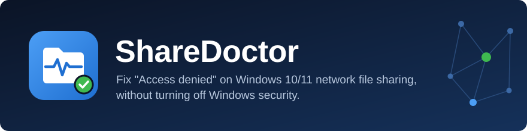
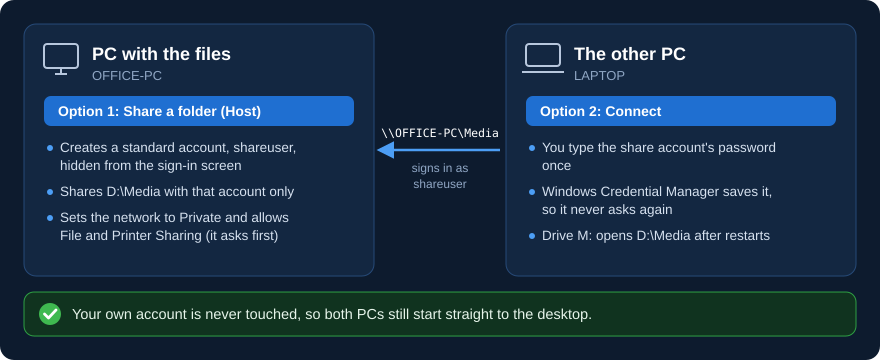
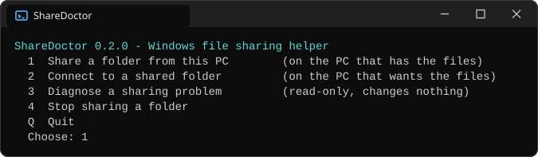
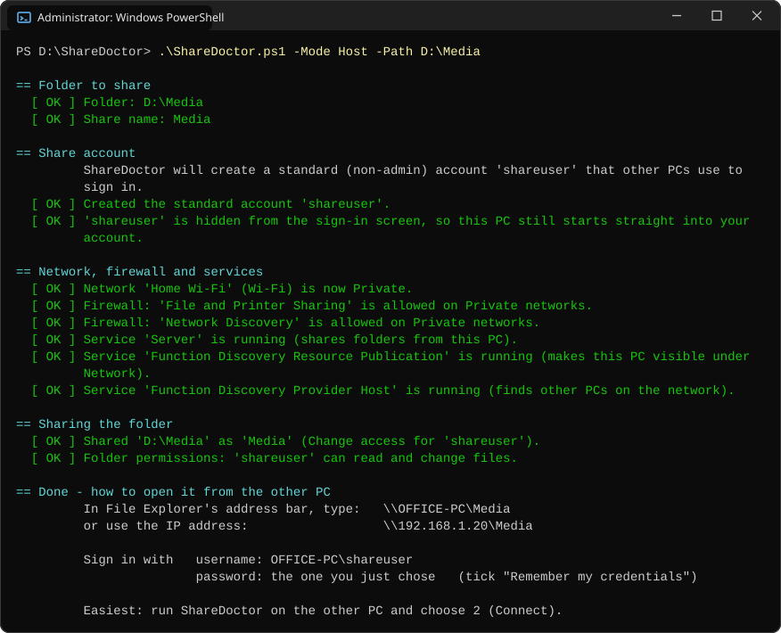
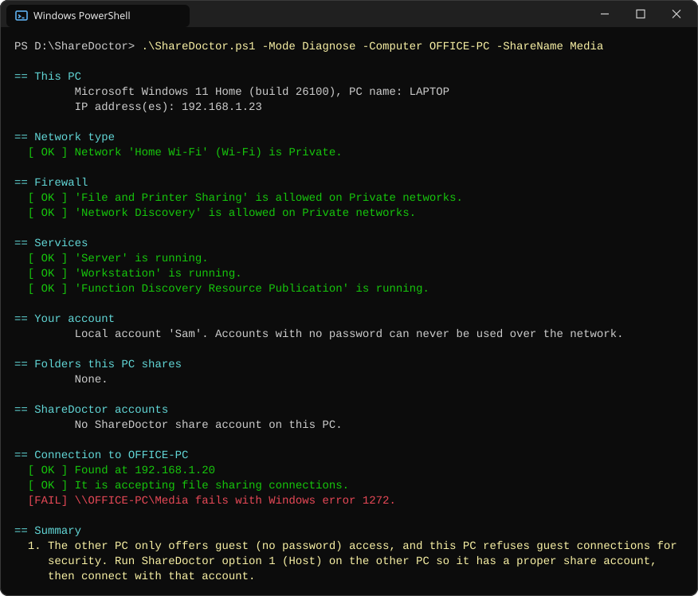

<p align="center">
  
</p>

<p align="center">
  <a href="https://github.com/byjoellobo/ShareDoctor/releases/latest"></a>
  <a href="https://github.com/byjoellobo/ShareDoctor/actions/workflows/ci.yml"></a>
  
  
  <a href="LICENSE"></a>
</p>

ShareDoctor makes file sharing between Windows 10 and 11 PCs on the same network work again, and explains in plain words why it fails. It works *with* Windows security instead of switching it off. Nothing to install: unzip it and double-click.

**[Download the latest release](https://github.com/byjoellobo/ShareDoctor/releases/latest)** | [Quick start](#quick-start) | [Error codes](#errors-it-explains) | [Undo everything](#undo-everything)

## The problem

You share a folder or a drive and turn off "password protected sharing", like you could on older Windows. The other PC then just says **Access denied** or **Windows cannot access \\\\PC\\Share**, and gives no reason.

## Why it happens

- Newer Windows versions refuse password-less ("guest") connections to shared folders, and Windows 11 24H2 tightened this further. Turning off password-protected sharing doesn't help any more, and Windows doesn't tell you that's the cause.
- Accounts with **no password** can never be used over the network.
- If you sign in with a **Microsoft account**, other PCs need your email address and account password. Your PIN won't work.
- Networks marked **Public** hide the PC and block sharing.
- Third-party antivirus firewalls often block sharing as well.

## What ShareDoctor does

<p align="center">
  
</p>

| Option | Run it on | What it does |
|---|---|---|
| **1 Share a folder** (Host) | the PC that has the files | Creates a standard (non-admin) account just for sharing and hides it from the sign-in screen. Shares the folder with that account only, sets your network to Private (it asks first), turns on File and Printer Sharing and Network Discovery in the firewall for Private networks, and starts the sharing services. Then it prints exactly what to type on the other PC. |
| **2 Connect** | the PC that wants the files | Checks the other PC can be reached, saves the share account's password once in Windows Credential Manager, tests access, maps a drive letter that comes back after restarts, and opens it. |
| **3 Diagnose** | either PC | Read-only: it changes nothing. Checks the network type, firewall, services and your account type, lists shares, tests a connection, and **explains the actual reason** in plain words, with a numbered list of fixes. |
| **4 Stop sharing** (Remove) | the PC that has the files | Removes the share and its folder permission. It can also delete the share account. Your files are never touched. |

### Will it add a login screen to my PC?

**No.** Your own account isn't touched, so if it has no password it stays that way. The share account is used only by other PCs over the network, and ShareDoctor hides it from the sign-in screen, so the PC still starts straight to your desktop. Its password is typed once on each other PC and saved there.

### What it deliberately doesn't do

- It never turns guest access back on, and never changes how connections are signed or encrypted. It never enables the old SMB1 protocol.
- It never changes your own account: not its password, PIN, type, groups or sign-in.
- It never gives the share account admin rights, and never shares a folder with Everyone.
- It never shares your whole Windows drive (for example `C:\`) or the Windows folder.
- It never opens file sharing on Public networks (cafe, hotel or airport Wi-Fi).
- No telemetry. The only network traffic goes to the PC you name.

Those protections keep other people on your Wi-Fi out of your files, and "fixes" that depend on switching them off tend to break with the next Windows update. ShareDoctor uses a normal password-protected account instead, which works on every current version of Windows.

### Security notes

- The share account is a standard user, not an admin. It is hidden from the sign-in screen, its password never expires (it works like a shared key), and it can't change its own password.
- Share permission goes to the share account only, never to Everyone.
- ShareDoctor sets a network to Private only after you confirm.
- ShareDoctor only reuses or deletes accounts it created itself. It recognises them by the description `File sharing account (created by ShareDoctor)`.
- On the other PC, the password is passed to Windows' own `cmdkey` tool, so for a moment it is visible to programs running as you and to administrators. On PCs where command-line auditing is switched on (some company PCs), it can also end up in the Security event log. Windows Credential Manager is still the standard place to keep it.
- ShareDoctor never prints or logs a password.

## Quick start

1. **[Download the zip](https://github.com/byjoellobo/ShareDoctor/releases/latest)** and unzip it on **both** PCs.
2. Right-click `ShareDoctor.cmd`, choose **Properties**, tick **Unblock**, and click **OK**. You only do this once; it clears the "downloaded from the internet" flag.
3. **On the PC with the files:** double-click `ShareDoctor.cmd` and choose **1**. Give it the folder and a password for the share account. Windows asks for admin permission.
4. **On the other PC:** double-click `ShareDoctor.cmd` and choose **2**. Type the PC name (or IP address) and the share name that step 3 printed, then the password.

If something fails, choose **3** on either PC. It tells you what's wrong and how to fix it.

<p align="center">
  
</p>

<details>
<summary><b>See what option 1 (Host) prints</b></summary>
<br>
<p align="center">
  
</p>
</details>

## Command line

Everything the menu does also works from PowerShell:

```powershell
.\ShareDoctor.ps1 -Mode Host -Path 'D:\Media' -ShareName Media             # add -ReadOnly for read-only access
.\ShareDoctor.ps1 -Mode Connect -Computer OFFICE-PC -ShareName Media -DriveLetter M
.\ShareDoctor.ps1 -Mode Diagnose -Computer OFFICE-PC -ShareName Media
.\ShareDoctor.ps1 -Mode Diagnose -Yes -Json > diagnose.json                  # read-only report as JSON
.\ShareDoctor.ps1 -Mode Remove -ShareName Media
```

For scripts, `-Yes` answers yes to every question and never prompts, and `-Password` takes the share account's password as a SecureString:

```powershell
$password = Read-Host 'Password for the share account' -AsSecureString
.\ShareDoctor.ps1 -Mode Host -Path 'D:\Media' -ShareName Media -Password $password -Yes
```

Host and Remove need admin rights. For a fully unattended run, start them from an administrator PowerShell window. From a normal window ShareDoctor opens an administrator window itself, and because it never passes a password between windows, that window asks for it.

| Option | Used by | Meaning |
|---|---|---|
| `-Mode` | all | `Menu` (default), `Host`, `Connect`, `Diagnose` or `Remove`. |
| `-Path` | Host | The folder to share. |
| `-ShareName` | Host, Connect, Diagnose, Remove | The share name other PCs see. Host suggests one from the folder name. |
| `-UserName` | Host, Connect, Remove | The share account's name. Default: `shareuser`. |
| `-Password` | Host, Connect | The share account's password as a SecureString. Asked for if missing. |
| `-Computer` | Connect, Diagnose | The name or IP address of the PC that has the files. |
| `-DriveLetter` | Connect | The drive letter to map, for example `M`. |
| `-NoDriveLetter` | Connect | Don't map a drive letter. |
| `-NoOpen` | Connect | Don't open File Explorer at the end. |
| `-ReadOnly` | Host | The share account can read files but not change them. |
| `-Yes` | all | Answer yes to every question and never prompt. A missing required value exits with code 2. |
| `-Json` | Diagnose | Print the results as JSON instead of text. |

**Exit codes:** `0` success (Diagnose: no problems), `1` error, `2` cancelled or a required value missing with `-Yes`, `3` Diagnose found at least one problem.

## Errors it explains

ShareDoctor reads the Windows error code, so it works in any display language. These are the ones it explains:

| Code | Meaning |
|---|---|
| 5 | Access denied. The account used isn't allowed into that share or folder. |
| 51 / 53 / 1231 / 1232 | The PC can't be reached: it's off, on a different network or a guest Wi-Fi, set to Public, or blocked by a firewall. |
| 64 | The connection dropped part-way, usually because of antivirus/firewall software or an unstable network. |
| 67 | The PC answered, but no share has that name. |
| 86 / 1326 | Wrong username or password (or a PIN was used instead of the Microsoft account password). |
| 1219 | Already connected to that PC under a different username. Connect offers to disconnect the old connection. |
| 1272 | The other PC only offers guest access, which this PC refuses. Run Host mode on the other PC. |
| 1327 | Account restriction, usually a blank password. |
| 1330 / 1331 / 1909 | The password expired, the account is disabled, or the account is locked out. |

Here is Diagnose on the other PC, finding the most common cause:

<p align="center">
  
</p>

## Undo everything

- **On the PC with the files:** choose option **4** to remove the share and its folder permission, and optionally the share account (along with its hidden sign-in entry). The firewall and network-type changes stay, because they are standard Windows settings that are safe to keep.
- **On the other PC:** `net use M: /delete` removes the drive letter, and `cmdkey /delete:OFFICE-PC` removes the saved password.

## Requirements

- Windows 10 (version 1809 or later) or Windows 11, including 24H2 and later. Home, Pro, Enterprise or Education, in any display language.
- The built-in Windows PowerShell 5.1. PowerShell 7 works too.
- Admin rights only on the PC that has the files. Nothing else to install.

## Status

**v0.2.0.** Every change is checked automatically: lint, more than 200 unit tests on Windows PowerShell 5.1 and PowerShell 7, and an end-to-end test that shares, connects, diagnoses and removes a real share on a Windows machine. Two-PC checks, such as "the PC still starts straight to the desktop", are done by hand; see [docs/TESTING.md](docs/TESTING.md) for the test plan and results. Changes are listed in the [changelog](CHANGELOG.md).

If something doesn't work, please [open an issue](https://github.com/byjoellobo/ShareDoctor/issues/new?template=bug_report.md) with your Windows version and the output of `.\ShareDoctor.ps1 -Mode Diagnose -Json` (you can blank out PC names).

### For contributors

[SPEC.md](SPEC.md) is the source of truth for how ShareDoctor behaves, and [docs/TESTING.md](docs/TESTING.md) explains how to run the checks. Tagging `vX.Y.Z` builds the release zip and publishes the GitHub Release.

## License

MIT. See [LICENSE](LICENSE).
